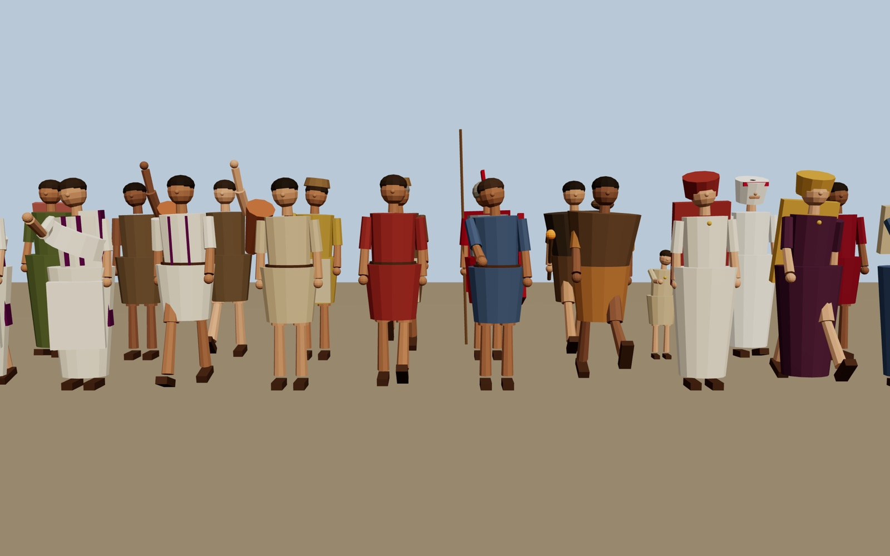
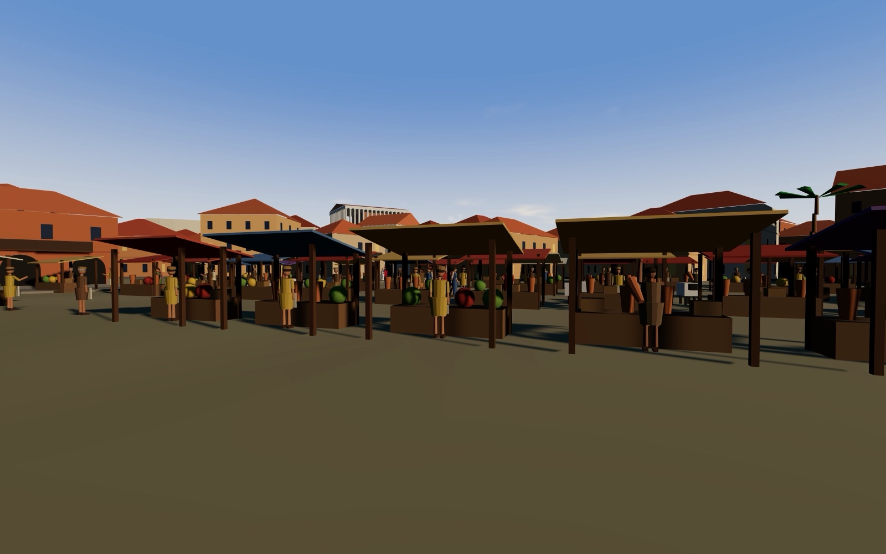
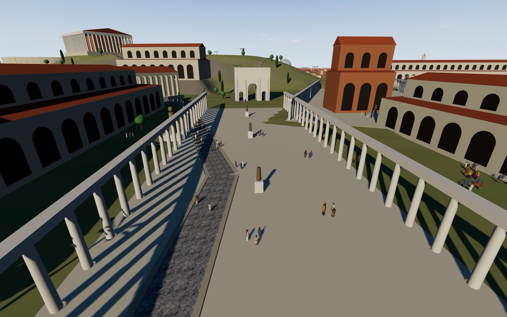
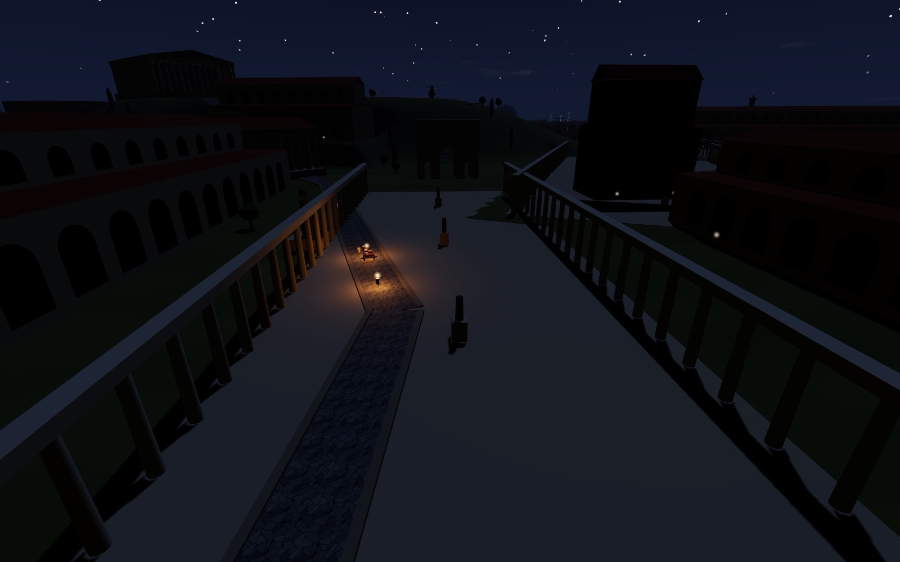
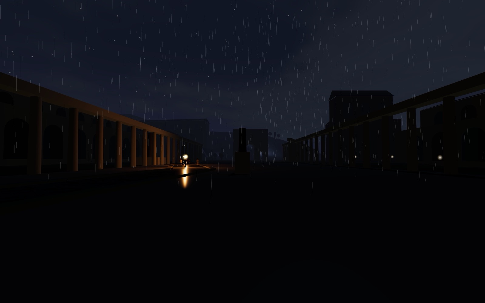
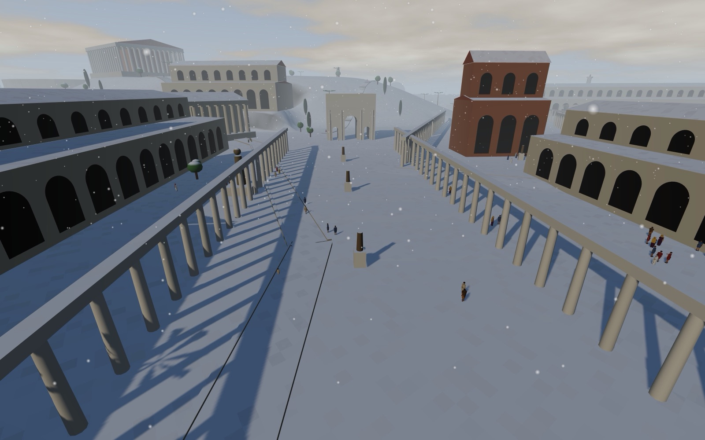

# Fantasy World Builder

הפעלה: `python3 -m wwii_build.fantasy` ← http://127.0.0.1:8790/ (גם כדף "Fantasy World Builder" בדשבורד).
נתונים: `~/.wwii-fantasy/fantasy.db` (משתנה `FANTASY_DATA_DIR`). רישום ה־Delivers במנהל: `python3 -m wwii_build.fantasy register --manager-db <נתיב>`.

## מודלים (מקומיים, בלי עלות)
- Qwen3-VL-30B-A3B דרך llama.cpp (`llama-server`, פורט 8080) — קורא תמונות וטקסט ומתכנן את העולם. אם הוא כבוי, המסך מציע להפעיל אותו (המשקולות כבר במטמון של Hugging Face).
- qwen2.5:14b דרך Ollama — גיבוי לטקסט בלבד.
- בלי מודל: חוקי מילים בעברית ובאנגלית.
- הפלט מוגבל ב־JSON Schema, כך שהתוכנית תמיד תקינה.

## מפת הפרויקט
- `rome476.py`: רומא ב־476 בקנה מידה אמיתי (‎2.1×2.1 ק״מ): הטיבר והאי, 5 גשרים, שבע הגבעות, 41 מבנים מרכזיים, דרכים ורבעים. המקורות מפורטים בקובץ ובמסך.
- בלי מפה היסטורית נבנית מפת פרויקט מהתוכנית: נהרות מכיוון לכיוון, גבעות, ארמון ("על גבעה במזרח"), רבעים בסגנון משלהם, מבנים מרכזיים וחומות.
- מקש M: מפה דו־ממדית עם שמות, שינוי העולם בפרומפט (עם תמונה), השוואת לפני/אחרי, אישור, גרסאות וחזרה לגרסה קודמת.

תנועה: חצים או WASD, גרירת עכבר להסתכלות, Shift לריצה, T לעיצוב חדר, M למפת הפרויקט.

## עדכון: ימי הביניים המוקדמים, כניסה לבתים, Blender וספרייה
- רומא: שווקים עם דוכנים, כנסיות התקופה (עם תאריכים), כבשני סיד עם עשן, גני ירק, עדרים בפורום ובקירקוס, סירות וטחנות צפות בטיבר.
- E ליד דלת: כניסה לכל בית (חדרים לפי גודל הבית) או לארמון. T בפנים: עיצוב חדר.
- בארמון, פרומפט כמו "שחזר את הארמון כפי שהיה באמת": פנים דומוס פלאוויה (אולם המלך, בזיליקה, לרריום, פריסטיל עם מזרקה מתומנת, חדר משתאות). המקורות מופיעים בהצעה.
- לחיצה בעכבר על בית, אנדרטה, ארמון או עץ: כותבים מה להוסיף או לפרט, המודל המקומי מתכנן (בנוי על עובדות היסטוריות ובוטניות), ואחרי אישור Blender בונה דגם glb (או עץ מפורט).
- מקש L: ספרייה. כל דגם, עץ, חדר, שחזור ותוכנית עולם נשמרים אוטומטית. אפשר להחיל אותם על אובייקט נבחר או להציב עותק בעולם.
- Blender 5.3 מותקן ב־/Applications (Homebrew). הסקריפט: `blender_detail.py`.

## עדכון: רומא בתפארתה — עיר חיה (315 לספירה)
- "רומא בתפארתה" בפרומפט (או "רומא בתפארתה, 315" ברשימת המפות) ← `rome315.py`: בלי כנסיות, כבשני סיד וגני ירק; עם מרחצאות קונסטנטינוס, מקדש סול, פסל הפרש בפורום, האובליסק בקירקוס, המקלום מגנום, שוק הדגים ושוק המעדנים. מצב: בלי בלאי ובלי הריסות.
- 4 Delivers חדשים (סה"כ 12), כל אחד עם ידע תקופה (`knowledge/rome_imperial.json`, 25 עובדות עם מקורות):
  - מעצב התלבושות ← בונה הדמויות (Blender): 20 סוגי אנשים עם שלד ו־4 אנימציות (הליכה, עמידה, דיבור, ישיבה): סנאטורים בטוגה עם פס ארגמן, פרשים, אזרחים בטוניקות צבועות, פאנולה לגשם, מטרונות בסטולה ופאלה, סוחרים, סבלים, חיילים, ויגילים עם לפיד, ילדים עם בולה, בתולת וסטה, נושאי אפריון.
  - אדון מזג האוויר: הסתברויות לפי חודש (בהיר, מעונן, גשם, סערה, ערפל, שלג), זריחה ושקיעה של רומא.
  - במאי החיים: 2,600 הולכי רגל, מוכרים בכל דוכן, קונים בשווקים, קבוצות משוחחות בפורום ובמקדשים, עגלות שוורים ופרדות (חוק יוליוס: רובן בלילה), אפריונים עם 4 נושאים ואציל יושב, סירות בטיבר, משמר לילה.
- יום ולילה: שעה = דקה. השמש זזה לפי החודש, שמיים עם עננים וכוכבים, אורות בחלונות, פנסים ולפידים. גשם (רטיבות ומשטחים מבריקים), סערה עם ברקים, ערפל, שלג שמצטבר על גגות ועל הקרקע. השורה העליונה מראה תאריך, שעה, "השעה ה־N של היום הרומי" ומזג אוויר.
- שבילים: דרכים ראשיות מרוצפות באבני בזלת מצולעות עם מדרכות מוגבהות.
- MCP: `python3 -m wwii_build.fantasy.mcp_server` (stdio, בלי ספריות חיצוניות). כלים: list_worlds, create_world, world_summary, rebuild_life, propose_world_edit, resolve_world_edit, set_world_clock, search_knowledge, list_delivers, recent_runs, library.

     
